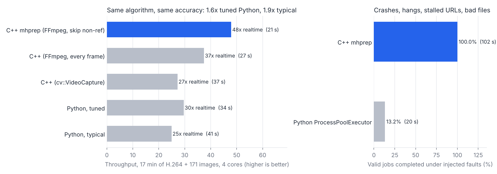

# mhprep: media preprocessing service for the Magic Hour API

C++20 service that turns raw user uploads into the few files worth sending to a generative-media API. It splits videos into scenes, picks one sharp keyframe per scene, crops faces, and drops near-duplicate shots and re-uploads. On a 17-minute held-out corpus with 434 ground-truth cuts it runs at **48× realtime on 4 cores, 1.6× a tuned Python implementation of the same algorithm and 1.9× a typical one, with identical accuracy** (scene-cut F1 0.98). Under injected crashes, hangs and stalled URLs it **finished 100% of valid jobs, while the Python pool finished 13%**. Its API serves **84k req/s with p99.9 under 10 ms at 64–256 concurrent clients, with every worker saturated**.

**Stack:** C++20, CMake, Linux/POSIX (posix_spawn, epoll, signalfd, timerfd, eventfd, rlimits), OpenCV 4.6 (DNN, imgproc), FFmpeg libavcodec/libavformat/libswscale, cpp-httplib, nlohmann/json, GoogleTest, Docker. The benchmark harness and Python baseline are Python 3 + OpenCV.



## Why it exists

People send Magic Hour long phone videos and folders of near-identical photos. Every frame or image that reaches an endpoint costs credits and upload time. Most of that input is redundant: the same shot appears twice, a burst has 6 copies of one photo, and the face is 8% of the frame. `mhprep` sits in front of the API (or in front of the [render orchestrator](../render-orchestrator)) and emits a manifest of what is actually worth rendering:

```
upload.mp4 ──▶ scenes [0-89, 90-209, ...] ──▶ keyframe per scene ──▶ dedupe ──▶ face crops (512²)
                                                                         │
photo_041.jpg ─▶ pHash + colour layout ─▶ seen this tenant before? ──────┘──▶ manifest.json
```

## Results

All numbers are from `bench/run_bench.py` on a 4-core Xeon @ 2.3 GHz, with 4 workers and 3 runs each (median shown). Raw output is in `results/*.json`.

### Throughput and accuracy (held-out test corpus)

The corpus has 48 H.264 videos (720p and 1080p, 17.0 min, 30,521 frames, 434 hard cuts) plus 171 images in 113 near-duplicate groups.

| Implementation | Wall time | Realtime | Speedup | Scene cuts P / R | Shot dedup P / R |
|---|---|---|---|---|---|
| **C++ mhprep** (FFmpeg decoder, skip non-ref frames) | **21.2 s** | **48×** | **1.62× / 1.93×** | 0.973 / 0.986 | 0.927 / 0.856 |
| C++, FFmpeg decoder, every frame | 27.2 s | 37× | 1.26× / 1.50× | 0.966 / 0.982 | 0.921 / 0.766 |
| C++, cv::VideoCapture | 37.4 s | 27× | 0.92× / 1.09× | 0.966 / 0.982 | 0.933 / 0.776 |
| Python, tuned (grab/retrieve, 1 thread per process) | 34.3 s | 30× | 1.00× | 0.966 / 0.982 | 0.933 / 0.776 |
| Python, typical (`cap.read()`, default threads) | 40.9 s | 25× | 0.84× | 0.966 / 0.982 | 0.933 / 0.776 |

The speedup column is relative to tuned Python / typical Python. Image dedup on the same corpus was precision 0.944 and recall 0.879 for every implementation.

**The honest reading:** written as the same algorithm on top of the same OpenCV calls, C++ alone buys nothing (`cv::VideoCapture` in C++ is slightly *slower* than tuned Python, because OpenCV 4.6's C++ capture can't be told to use one decode thread). The speedup comes from going under OpenCV, which is awkward from Python:

- **Decoding with libavcodec directly**, with `skip_frame = AVDISCARD_NONREF`. That skips decoding B-frames, which are 72% of a default x264 stream. Scene detection runs on the reference frames that remain, and cut recall went *up* slightly (0.982 → 0.986), because consecutive analyzed frames are further apart.
- **A YUV → small BGR conversion in one `sws_scale` pass.** Full-resolution BGR is only ever produced for the few frames that might become keyframes.
- **One decode thread per process**, so 4 workers on 4 cores don't oversubscribe into 16 threads.

The Python baseline is a fair implementation of the same pipeline (`bench/py_baseline.py`, line for line the C++ OpenCV backend). On the dev corpus it produced *identical* scenes and dedup decisions to the C++ OpenCV path, which is how I checked the comparison is apples to apples.

### Reliability under faults (`results/chaos.json`)

The fault-injected run uses the same corpus plus 7 bad inputs: 3 URLs whose server sends 64 KB and then stalls forever, a truncated MP4, random bytes, an empty file and a missing file. On top of that, 3% of job attempts segfault and 2% hang, through `MHPREP_CHAOS`, which uses the same hash in both implementations so both see the same faults.

| | Valid jobs completed | Wall time | What happened |
|---|---|---|---|
| **C++ mhprep** | **219 / 219 (100%)** | 102 s | 8 crashes and 13 timeouts were retried on fresh workers (18 retries, 25 worker spawns). The 7 bad inputs failed cleanly: 4 as `input` errors and 3 stalled URLs as `timeout` after 3 attempts. |
| Python `ProcessPoolExecutor` | 29 / 219 (13%) | 20 s | The first segfault raised `BrokenProcessPool` and failed every pending job. |

The C++ wall time is dominated by the 20 s job deadline, which the stalled URLs hit 3 times each. This is a deliberately long deadline. A production setting would also use the FFmpeg I/O timeout (`io_timeout_ms`), which turns a stall into an immediate input error.

### HTTP API (`results/http_tail.json`)

The load is `wrk -t2 -cN -d20s`: 99.8% `GET /v1/jobs/{id}` and 0.2% `POST /v1/jobs`, while all 4 workers are busy decoding a 144-video backlog.

| | Result |
|---|---|
| Clients | Before: p99 · p99.9 · max · errors | After: p99 · p99.9 · max · errors | req/s before → after |
|---|---|---|---|
| 64 | 2.6 ms · 5.1 ms · 13 ms · 0 | 5.1 ms · 8.5 ms · 20 ms · 0 | 93.9k → 83.5k |
| 72 | **554 ms · 1.45 s · 1.67 s · 24** | 3.9 ms · 7.7 ms · 20 ms · 0 | 93.6k → 86.1k |
| 256 | 1.4 ms · 4.3 ms · 15 ms · **156** | 6.2 ms · 19 ms · 59 ms · 0 | 91.0k → 84.3k |

End to end (596 image jobs at 20/s, submit → result): p50 59 ms · p99 98 ms, 0 failures.

The tail used to be large and erratic: the first published p99.9 was 923 ms, and runs ranged from 5 ms to 1.4 s. It had two causes, and both are now fixed (`results/http_tail.json`):

- **Connections waited for threads.** cpp-httplib serves a keep-alive connection on one pool thread until the client disconnects. With a fixed pool of 64, the 65th client waits for someone else to leave. At 72 clients that gave a p99 of 0.55 s and timeouts; at 256 clients, 156 requests timed out and the latency numbers only covered the clients that got a thread. The pool is now elastic (`ElasticPool` in `server.cpp`). When no thread is idle it starts one, up to 4096, and threads above a floor of 16 exit after 30 s idle.
- **SYNs were dropped.** Packaged httplib listens with a backlog of 5, so a burst of connects overflowed the accept queue: 83 drops in one 20 s run, per `TcpExt:ListenOverflows`. Each dropped client waited out the 1 s SYN retransmit. httplib neither exposes the option nor the socket, so after binding, the server finds its listening socket in `/proc/self/fd` and calls `listen()` again with a backlog of 4096. On Linux that updates a socket that is already listening. Overflows are now 0 in every run.

`tests/test_server.cpp` holds 200 keep-alive clients open at once and requires every one to get an answer within 2 s. The old pool fails it after 15 s; the new one passes in 54 ms.

The new server does about 10% fewer requests per second at 64 clients, and that is not a like-for-like loss. The old server's higher number came partly from clients it wasn't serving. With reconnects ruled out (unlimited keep-alive), the old server still had a p99 of 0.71 s and timeouts at 64 clients, while the new one stays at 2.8 ms. Serving every connection at once costs more CPU per request on this oversubscribed 4-core box: 29 µs vs 25 µs of server CPU per request. That trade is the right one for an API where a stalled client is a failed upload.

The first version managed 580 req/s, with p90 latency at 135 ms. cpp-httplib pins a keep-alive connection to one pool thread, and it closed connections every 5 requests, so 32 clients were queuing behind 16 threads. The fix was to size the pool for connections rather than cores and to raise the keep-alive limits. Workers also run at `SCHED_BATCH` with nice 10, so a saturated decoder pool can't starve the control plane.

The benchmark also caught a shutdown hang. On SIGTERM, a helper thread and the main thread both called `HttpServer::stop()`, and two threads joining one `std::thread` is undefined behaviour; here it hung. Now `on_stop` only calls the non-blocking `shutdown()`, and joining is serialized.

### Durability (`--db`, Postgres)

With `--db` set, every job is committed to Postgres before `POST /v1/jobs` returns 202, and a restarted supervisor resumes whatever was queued or running.

| Test | Result |
|---|---|
| `kill -9` the supervisor with 40 jobs submitted (16 done, 4 on workers, 20 queued) | Workers exit with it (`PR_SET_PDEATHSIG`). On restart all 24 unfinished jobs resume, and 40/40 succeed. |
| Durable submit throughput, `wrk -t4 -c64 -d10s` POST-only | 5.3k req/s · p50 11 ms · p99 27 ms |
| Same, one commit per write instead of group commit | 383 req/s · p50 164 ms · p99 253 ms |

One commit per job is slow because each one waits for its own WAL flush. A single writer thread takes every write queued since its last commit, which is about 90 at this load. It sends them as one libpq pipeline in one implicit transaction, so a batch costs one round trip and one fsync. That is 13.8× the throughput. Pipelining alone took it from 2.2k to 5.3k req/s, because a 90-statement batch had been spending most of its time on round trips.

The semantics are deliberate:

- **A 202 means durable.** The insert commits before the job enters the in-memory queue, so nothing can dispatch it ahead of its own row. If the store can't commit within 5 s the API answers 503, and the row is guaranteed not to exist. A queued insert is withdrawn, and a failed batch is never retried behind the caller's back.
- **At-least-once.** Started, retried and finished states are written behind on the same thread, in order. If the process dies first, the job is still `queued` or `running` in Postgres and runs again. Its output directory is keyed by job id, so a rerun overwrites rather than duplicates. An attempt interrupted by a crash or a drain deadline is logged but doesn't count toward quarantine.
- **Graceful stop doesn't cancel.** In memory-only mode SIGTERM fails queued jobs. In durable mode they stay queued for the next start.
- **Cross-upload dedup survives restarts.** Each new unique keyframe or image hash is stored with its job, and the per-tenant BK-trees are rebuilt at startup.
- **One supervisor per database.** A session-level advisory lock is held on its own connection, so a second supervisor fails at startup instead of double-running recovered jobs. Postgres releases the lock automatically if the holder dies.
- **Evicted records are still served.** `GET /v1/jobs/{id}` falls back to Postgres for jobs no longer held in memory.

### Dissolves and fades (`"scene_gradual": true`, `results/gradual.json`)

A dissolve changes each frame by only a few levels, so the per-frame cut test never fires on a slow one. A second test looks at the last 0.4 s, and the last 0.8 s for long transitions. It checks whether the window's endpoints differ a lot *and* every frame in between sits on the straight line from one endpoint to the other. Pixelwise linear interpolation is exactly what a dissolve is. Camera motion moves content rather than blending it, so its middle frames fall far off that line, and a hard cut inside the window is a step, not a ramp. A fade through black is two ramps, and is reported as one cut when the picture comes back.

The ground truth for this comes from `make_corpus.py --gradual 0.5`, which blends shot ends into 15–45-frame (0.5–1.5 s) dissolves and fades, so the frame interval of every transition is known. Thresholds were tuned on a 16-video dev set and scored once on a 48-video held-out set:

| Held-out, 426 cuts | Hard cuts (363) | Dissolves (40) | Fades (23) | Precision | F1 |
|---|---|---|---|---|---|
| Cut test only | 355 | 25 | 23 | 0.981 | 0.963 |
| + gradual test | 354 | **33** | 22 | 0.976 | **0.968** |

Dissolve recall rises from 63% to 83%, at no measurable speed cost (29.3 s vs 29.4 s on the main corpus). Fades were already caught, because a fade to black changes the picture fast enough for the per-frame test.

The test is **off by default** for two reasons. On the hard-cut-only corpus it costs a little (F1 0.979 → 0.972, 5 more false cuts, from slow, smooth camera moves that look like ramps). And it misses dissolves between moving shots: motion during the blend pulls the middle frames off the line. A 1.5 s dissolve between similar-looking shots is also too gentle to clear the threshold. Turn it on for edited content where dissolves are common.

### What reaches the API

On the main C++ run, 326 MB of video became 72 MB of JPEG keyframes and face crops (4.5× fewer bytes), and 333 API-ready face crops came out. Within individual videos, 96 repeated-shot keyframes were flagged as duplicates (precision 0.93). Across uploads, 60 of 171 images were flagged as duplicates of an earlier upload from the same tenant (94% precision). The corpus deliberately reuses ~35 source clips, so its cross-upload duplicate rate is higher than real traffic; `results/throughput.json` shows the split.

## Resume bullet

> Built a C++20 media preprocessing service (OpenCV, FFmpeg libavcodec, Linux epoll/signalfd/timerfd, multi-process worker pool) that splits uploads into scenes, extracts keyframes and face crops, and removes near-duplicates before they hit a generative-media API. It runs at 48× realtime on 4 cores, 1.6–1.9× a Python implementation of the same algorithm at identical accuracy (scene-cut F1 0.98 on 434 labelled cuts). It completed 100% of valid jobs under injected segfaults, hangs and stalled URLs vs 13% for a Python process pool, and serves 84k req/s with p99.9 under 10 ms from 64 to 256 concurrent clients while every worker is saturated (fixing a 1.4 s tail from thread pinning and a backlog-5 accept queue). Jobs are durable in Postgres and survive `kill -9`; group commit over a libpq pipeline sustains 5.3k durable submits/s, 13.8× committing each write on its own.

Shorter: *"C++20 video preprocessing service (OpenCV/FFmpeg, epoll worker pool): 48× realtime, 1.6–1.9× faster than Python at equal accuracy, 100% vs 13% job completion under injected crashes and hangs, 84k req/s at p99.9 < 10 ms."*

## Architecture

```
            HTTP (cpp-httplib, 64 threads)             CLI: mhprep run --list inputs.txt
                   │ submit / describe / wait                  │
                   ▼                                           ▼
   ┌───────────────────────── Supervisor (one epoll loop, main thread) ─────────────────────┐
   │ eventfd ← new jobs     signalfd ← SIGCHLD / SIGTERM / SIGINT     timerfd ← next deadline │
   │ job table + FIFO queue · per-tenant BK-tree of pHashes (cross-upload dedup)            │
   │ retry with backoff-free requeue · poison quarantine after N attempts · bounded memory  │
   └──────┬──────────────┬──────────────┬──────────────┬────────────────────────────────────┘
          │ socketpair, length-prefixed JSON, nonblocking on the supervisor side
          ▼              ▼              ▼              ▼
     mhprep worker  mhprep worker  mhprep worker  mhprep worker     (posix_spawn + exec)
     RLIMIT_AS · SCHED_BATCH/nice 10 · PR_SET_PDEATHSIG · face model loaded once
     pipeline: libavcodec decode (skip non-ref) → sws_scale to 256 px → HSV scene detector
               → sharpest frame per scene → pHash + colour-layout dedup → SSD face detector → crops
```

### The parts that are hard

- **Isolation without polling.** Each job runs in its own worker process. The supervisor waits on one `epoll_wait` with no timeout. The `timerfd` is re-armed to the earliest job deadline, `SIGCHLD` arrives through `signalfd` (coalesced signals are handled by reaping in a `WNOHANG` loop), and HTTP threads wake the loop through an `eventfd`. A job past its deadline gets its worker `SIGKILL`ed, because a decoder blocked in `read()` can't be cancelled cooperatively. A replacement is spawned with exponential backoff if workers keep dying at startup.
- **Retry semantics.** Crashes, timeouts and OOMs are retried on a fresh process, and a job goes to the back of the queue so a poison file can't monopolise workers. After `max_attempts` it is quarantined with its attempt log. Bad inputs (`InputError`) are never retried. A worker that hit its memory limit announces `worker_exiting` with its result, so the supervisor doesn't hand it another job in the gap before it exits. A test caught that race.
- **Memory bombs.** Each worker runs under `RLIMIT_AS`, so a decompression bomb ends in `bad_alloc` inside that worker (reported as `oom`) rather than the kernel OOM killer picking a victim.
- **Process hygiene.** Workers are exec'd, not forked from a multithreaded process, and get a clean signal mask through `posix_spawnattr`. They run in their own process group, so Ctrl-C drains the supervisor instead of killing jobs mid-write, and `PR_SET_PDEATHSIG` stops them from outliving the supervisor. On SIGTERM the server stops accepting work, cancels queued jobs, lets running jobs finish (up to `--drain-ms`), then closes sockets and reaps.
- **Dedup that doesn't eat distinct outputs.** pHash alone flagged 23 false duplicates on the dev set. Most were the same model in different try-on outfits: same structure, different colours. Every BK-tree candidate within Hamming 8 is now verified against a 4×4 CIELAB colour layout, with the mean-L shift removed so exposure changes still match. That took false duplicates from 23 to 5 at nearly the same recall (85 vs 86 of 95 true pairs).
- **Durable without slowing the loop.** The epoll loop never waits on Postgres. Only `submit()` blocks, on an HTTP thread, until its row commits. Every state change is queued to one writer thread that group-commits through a libpq pipeline. The details are under *Durability*.
- **Dissolves without a model.** Gradual transitions are found by testing whether recent frames are a pixelwise linear blend of the window's endpoints, which separates blends from camera motion. The bookkeeping stops one transition turning into two cuts: a re-arm rule after every cut, and fade-out/fade-in pairing through black frames. The details are under *Dissolves and fades*.
- **Ground truth you can trust.** Corpus videos are assembled from segments whose cut points I placed, so cuts are known to the frame. Segments come only from intervals that ffmpeg's own `scdet` (threshold 3) considers a single shot. Thresholds were tuned on a separate dev corpus (seed 7) and reported on the test corpus (seed 1).

## Usage

```bash
scripts/fetch_models.sh                    # ResNet-10 SSD face model (5 MB)
cmake -S . -B build -G Ninja -DCMAKE_BUILD_TYPE=Release && cmake --build build
(cd build && ctest)                        # 41 GoogleTest tests
# The 10 job-store tests need Postgres; without it they're skipped:
MHPREP_TEST_PG="host=localhost user=postgres dbname=mhprep_test" ctest --test-dir build

# Batch
build/mhprep run --workers 8 --out out/ upload1.mp4 photo.jpg https://cdn.example.com/clip.mp4
build/mhprep run --list inputs.txt --report report.jsonl   # lines: "tenant<TAB>path-or-url"

# Service
build/mhprep serve --port 8080 --workers 8 --timeout-ms 120000 --mem-mb 3072
curl -XPOST localhost:8080/v1/jobs -d '{"input":"/data/clip.mp4","tenant":"acme"}'
curl 'localhost:8080/v1/jobs/1?wait_ms=30000'      # long-poll until done; returns the manifest
curl localhost:8080/metrics                         # Prometheus

# Durable: jobs survive a restart (or MHPREP_DB=...)
build/mhprep serve --port 8080 --db "host=localhost dbname=mhprep user=mhprep"

# One file, in process (debugging)
build/mhprep process clip.mp4 --options '{"backend":"opencv","faces":false}'
```

Per-job options: `backend` (`ffmpeg`|`opencv`), `skip_nonref`, `stride`, `faces`, `face_size`, `dup_radius`, `color_tolerance`, `scene_min_score`, `scene_ratio`, `scene_gradual`, `gradual_min_delta`, `gradual_max_residual`, `gradual_window_sec`, `io_timeout_ms`, `timeout_ms`, `write_assets`.

The Docker image builds and runs the tests in the build stage, and the runtime image uses `tini` so `docker stop` triggers a graceful drain. I couldn't build it in the dev environment I used, because it had no Docker daemon.

## Reproducing

```bash
# Sources: public test clips (opencv/opencv samples, PySceneDetect test videos) plus single-shot
# Magic Hour generations from earlier projects, in bench/sources/{videos,images}.
python bench/make_corpus.py --out corpus/dev  --seed 7 --videos 16   # tuning
python bench/make_corpus.py --out corpus/test --seed 1 --videos 48   # reporting
python bench/make_corpus.py --out corpus/gradual-dev  --seed 7 --videos 16 --gradual 0.5 --no-images
python bench/make_corpus.py --out corpus/gradual-test --seed 1 --videos 48 --gradual 0.5 --no-images
python bench/run_bench.py && python bench/plot.py
```

## Layout

```
include/mhprep/   phash, hash_index (BK-tree + verified DupIndex), scene, faces, video_source,
                  pipeline, ipc (framing), supervisor, job_store (Postgres), metrics
src/              implementations + main.cpp (CLI) + server.cpp (HTTP) + worker.cpp (+ chaos hooks)
tests/            GoogleTest: hashing, BK-tree vs brute force, scene detector, framing under every
                  split point, pipeline on both backends, supervisor crash/hang/OOM/retry/drain/dedup,
                  job store recovery/eviction/dedup-after-restart/group commit
bench/            corpus builder, Python baseline, evaluator, chaos + stall server, wrk script, plots
results/          benchmark output
```

## Limits and next steps

- The durable store keeps every job row forever. A retention job (or partitioning by `submitted_at`) is needed before long-running production use.
- One supervisor per database. Scaling out means sharding tenants across supervisors, or moving to `SELECT ... FOR UPDATE SKIP LOCKED` dispatch so several supervisors can share a queue.
- Gradual-transition detection (opt-in) misses dissolves between moving shots. A motion-compensated version of the linearity test, or a learned boundary model, would be the next step.
- Face crops aren't deduplicated across uploads, because the same person in two photos is usually a different, wanted crop.
- Next integration: post each manifest's unique keyframes and face crops as jobs to the render orchestrator.
